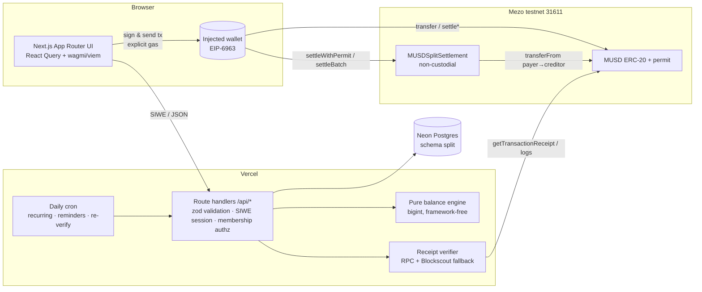

# MUSD Split

**Split shared costs. Settle them in MUSD on Mezo — verified on-chain before anyone's balance moves.**

### Live app: **https://musd-split.vercel.app** (Mezo testnet, chain 31611)

| | |
|---|---|
| Settlement contract | [`0x2d2F57887fA5a970344CeA9f1176BB761aFc2602`](https://explorer.test.mezo.org/address/0x2d2F57887fA5a970344CeA9f1176BB761aFc2602) · deploy tx [`0x1b9b0d…8cc86`](https://explorer.test.mezo.org/tx/0x1b9b0ddba43525b1fb363642f869011216440c7701b5997858e647002a48cc86) (block 16,372,569) |
| MUSD token (testnet) | [`0x118917a40FAF1CD7a13dB0Ef56C86De7973Ac503`](https://explorer.test.mezo.org/token/0x118917a40FAF1CD7a13dB0Ef56C86De7973Ac503) |
| Health | https://musd-split.vercel.app/api/health |
| Product spec | [`project.md`](./project.md) |

---

## What it is

Friends, flatmates and travellers share costs constantly, then lose hours to spreadsheets, mental maths and "did you pay me back?" messages. MUSD Split is one shared workspace where a group records what was spent, sees exactly who owes whom, and **settles with real MUSD transfers on Mezo** — with every payment verified from its on-chain receipt.

Two kinds of records are kept strictly apart:

- **Expenses** — what the group agreed was spent (off-chain ledger in Postgres, fully audited).
- **Settlements** — MUSD that actually moved on Mezo. A debt only shrinks when the server has verified the transaction receipt.

## Features (all working in the live app)

**Groups & people**
- Wallet sign-in (SIWE / EIP-4361) with EIP-6963 wallet discovery (MetaMask, Rabby, OKX…), network detection, *Add/switch to Mezo testnet*, *Add MUSD to wallet*, live MUSD balance.
- Profiles: display name, username, uploaded avatar (or a deterministic orb), shown everywhere; the wallet address stays authoritative.
- Groups with icon/colour/description, roles (owner/admin/member), membership checks on every API route.
- Invite links + QR codes with unguessable 192-bit tokens, optional expiry, use limits and revocation; public preview reveals no member list.

**Expenses**
- Equal, exact-amount, percentage and share-based splits; excluded members are never charged; live breakdown before saving (same engine as the server).
- Category, date, notes, receipt upload (PNG/JPEG/WebP/PDF ≤ 2 MB, magic-byte sniffed, stored in Postgres, members-only).
- Edit / delete with optimistic concurrency; **edits after a payment become auditable adjustments** (reason required, per-member balance deltas stored; settlements never rewritten).
- Expense detail with individual shares, FIFO coverage status (open / partly settled / settled), full version history, related payments.
- Recurring bills (weekly/monthly, anchor-day clamping) with reminders — creates expense records only, never moves funds.

**Balances & settlement**
- Deterministic bigint engine: net balances, pairwise "as recorded" debts, greedy min-cash-flow simplification; a real-data **debt map** toggles *As recorded ↔ Simplified*.
- Settle page with recipient profile + full address, amount (capped at what you owe), MUSD balance, BTC-for-gas, max network fee, explicit confirmation step.
- Three payment rails, all with explicit gas:
  1. **Direct MUSD `transfer`** (baseline).
  2. **Settlement contract with EIP-2612 permit** — one free signature + one transaction, duplicate-proof on-chain id.
  3. **Contract with approve** for wallets that can't sign permits.
- **Settle everything in one transaction** (`settleBatchWithPermit`) for all your creditors in a group.
- Tx hash is persisted *before* waiting; pending / delayed / failed / rejected states survive refresh; *Check again*, *Check chain for my payment* (log scan recovery) and manual hash entry.
- Payment requests (pending / paid / cancelled / declined / expired) — marked paid only by a verified settlement.
- Printable settlement receipt with explorer links, transaction history page.

**Staying in sync**
- Activity feed (group created, member joined, expense added/edited/adjusted/deleted, payment requested, settlement initiated/confirmed/failed/rejected) with tx links.
- Notification centre with unread counts (expense added, request received, settlement confirmed/received/failed, member joined, recurring reminders).
- Dashboard: you owe / owed to you / net, settle-up suggestions, requests, in-flight payments, recent expenses, confirmed settlements, upcoming bills, onboarding checklist.
- CSV export (formula-injection safe), ⌘K / Ctrl-K command palette, live network badge (block height), help/FAQ, risk disclosure, terms & privacy, OG image, sitemap/robots, 404 and error boundaries, Vercel Analytics + Speed Insights.

**Signature 3D hero** — a React Three Fiber constellation of member orbs joined by glowing MUSD debt threads. The example group's 14 recorded debts (computed by the real engine) visibly dissolve into the 5 payments that settle everyone. Lazy-loaded, DPR ≤ 1.75, pauses off-screen/hidden tab, static poster for `prefers-reduced-motion`.

## Architecture



## How a payment works

1. **Intent** — `POST /api/groups/:id/settlements` checks membership and the policy engine (amount ≤ what you owe this member on the simplified *or* direct route, minus anything in flight). It stores a `created` settlement with a random bytes32 id and the current block. No money has moved.
2. **Sign** — the browser sends `MUSD.transfer` (or `settleWithPermit(id, to, amount, …)`) with `gas = max(estimate × 1.3, floor)` — Mezo enforces the EIP-7623 calldata floor and the public RPC sometimes under-estimates.
3. **Persist** — the tx hash is posted immediately (`submitted`); a cheap pre-check rejects hashes sent by another wallet or to the wrong contract, so nobody can squat a hash.
4. **Verify (server)** — the receipt is fetched from `rpc.test.mezo.org` (with retries; the load-balanced RPC sometimes returns `null` for mined txs) and Blockscout as fallback, then checked: status `success`, sender = payer, tx target = MUSD (direct) or the settlement contract, a MUSD `Transfer` log from the official token with exact from/to/value, for contract payments a matching `Settled(settlementId, from, to, amount)` event, and the tx is not older than the intent.
5. **Confirm** — a conditional update flips `submitted → confirmed`, links the payment request, writes activity + notifications. RPC trouble → `delayed` (retried by the page and the daily cron). Reverted → `failed`. Mismatch → `rejected` (hash released so the real owner can still claim it).
6. **Uniqueness** — partial unique index on `tx_hash` for single settlements and on `(tx_hash, log_index)` for batch items; settlement ids are unique in the DB *and* single-use on-chain.

## Money maths & the rounding rule

- All amounts are `bigint` MUSD base units (18 decimals); decimal strings only at the edges (`parseAmount`, `formatAmount`). No floats.
- Shares are whole cents (0.01 MUSD). Each participant gets `floor(total × weight / Σweights)` cents; leftover cents (always fewer than the participant count) go one each to the **largest fractional remainder first; ties go to the payer first, then by wallet address ascending**. Shares always sum exactly to the total.
- Net balances always sum to zero; simplification preserves every member's net with at most *n − 1* transfers.
- Expense settlement status uses FIFO coverage: a member's outstanding debt is attributed to their newest shares first.

## Mezo / MUSD integration

| Contract (Mezo testnet) | Address |
|---|---|
| MUSD | [0x118917a40FAF1CD7a13dB0Ef56C86De7973Ac503](https://explorer.test.mezo.org/address/0x118917a40FAF1CD7a13dB0Ef56C86De7973Ac503) |
| **MUSDSplitSettlement (ours)** | [0x2d2F57887fA5a970344CeA9f1176BB761aFc2602](https://explorer.test.mezo.org/address/0x2d2F57887fA5a970344CeA9f1176BB761aFc2602) — deploy tx [0x1b9b0ddb…a48cc86](https://explorer.test.mezo.org/tx/0x1b9b0ddba43525b1fb363642f869011216440c7701b5997858e647002a48cc86) |
| BorrowerOperations (reference) | [0xCdF7028ceAB81fA0C6971208e83fa7872994beE5](https://explorer.test.mezo.org/address/0xCdF7028ceAB81fA0C6971208e83fa7872994beE5) |
| TroveManager (reference) | [0xE47c80e8c23f6B4A1aE41c34837a0599D5D16bb0](https://explorer.test.mezo.org/address/0xE47c80e8c23f6B4A1aE41c34837a0599D5D16bb0) |
| PriceFeed (reference) | [0x86bCF0841622a5dAC14A313a15f96A95421b9366](https://explorer.test.mezo.org/address/0x86bCF0841622a5dAC14A313a15f96A95421b9366) |
| StabilityPool (reference) | [0x1CCA7E410eE41739792eA0A24e00349Dd247680e](https://explorer.test.mezo.org/address/0x1CCA7E410eE41739792eA0A24e00349Dd247680e) |

Network: chain id **31611**, RPC `https://rpc.test.mezo.org`, explorer `https://explorer.test.mezo.org`, gas token BTC. Addresses verified against the official `mezo-org/musd` deployments (matsnet) and the Mezo docs. Config lives only in `src/config/chains.ts` and `src/config/contracts.ts`.

**MUSDSplitSettlement** (`contracts/contracts/MUSDSplitSettlement.sol`, Solidity 0.8.28, EVM london, optimizer 200): no owner, no admin, never holds funds — `transferFrom(payer → creditor)` in the same call. `settle`, `settleWithPermit` (front-run-safe try/catch permit), `settleBatch`, `settleBatchWithPermit` (≤ 32 items, atomic). Ids are payer-scoped (`keccak256(abi.encode(payer, id))`) so nobody can grief another payer's id; duplicates revert with `AlreadySettled`. OpenZeppelin `ReentrancyGuard` + `SafeERC20`, checks-effects-interactions, event `Settled(bytes32 indexed settlementId, address indexed from, address indexed to, uint256 amount)`. Creation bytecode on-chain matches the compiled artifact byte-for-byte; Blockscout source verification was submitted (hardhat-verify + Blockscout v2 API) but the explorer has not marked it verified yet.

## Tech stack

Next.js 16 (App Router, Turbopack) · React 19 · TypeScript strict · Tailwind CSS 4 · Radix primitives · wagmi 2 + viem 2 + TanStack Query · React Three Fiber 9 + drei · Neon Postgres (`@neondatabase/serverless`, raw parameterized SQL) · jose (HS256 session JWT) · zod 4 · Vitest · Hardhat 2 + OpenZeppelin 5 · Vercel (Fluid compute, Cron, Analytics). Fonts: Bricolage Grotesque (display), IBM Plex Sans (UI, tabular numerals), IBM Plex Mono (hashes).

## Local setup

```bash
npm install
vercel link --yes --project musd-split && vercel env pull .env.local --yes   # or copy .env.example
npm run db:migrate          # idempotent SQL → schema "split"
npm run dev                 # http://localhost:3000
```

Contracts (separate npm project):

```bash
cd contracts && npm install
npm test                    # Hardhat tests
npm run deploy:testnet      # reads PRIVATE_KEY at runtime from DEPLOYER_ENV_FILE; never stored in the repo
npm run verify:testnet
```

## Environment variables

See [`.env.example`](./.env.example): `DATABASE_URL`, `DATABASE_URL_UNPOOLED` (Neon integration), `SESSION_SECRET`, `CRON_SECRET`, optional `MEZO_RPC_URL`, `NEXT_PUBLIC_SITE_URL`. Public chain config is in code. No secret ever reaches the client bundle.

## Database schema (Postgres, schema `split`)

| Table | Purpose |
|---|---|
| `users`, `avatars` | profile per wallet address; avatar bytes (≤ 512 KB) |
| `auth_nonces` | single-use SIWE nonces with expiry |
| `groups`, `group_members` | groups, roles, status (active/left/removed) |
| `invites` | 192-bit tokens, expiry, max uses, revocation |
| `expenses`, `expense_participants` | current expense version + exact shares (numeric(78,0)) |
| `expense_revisions` | every version: snapshot, per-member deltas, adjustment flag, reason |
| `payment_requests` | requester/payer/amount/status/expiry, linked settlement |
| `settlements`, `settlement_batches`, `settlement_events` | intents → verified settlements, unique tx hash/log index, full status history |
| `activity`, `notifications` | group timeline; per-user notifications with read state |
| `receipts`, `recurring_expenses` | receipt bytes (≤ 2 MB, members-only); schedules |

Migration: [`db/migrations/001_init.sql`](./db/migrations/001_init.sql) (`npm run db:migrate`).

## Testing — latest results

| Suite | Command | Result |
|---|---|---|
| Unit (engine, verifier, recurrence, CSV, validation, gas policy) | `npm test` | **108 / 108 passed** (9 files), incl. 1,500-seed property tests: splits sum to totals, nets sum to zero, simplification preserves nets with ≤ n−1 transfers, edits = old nets + delta, determinism under shuffling |
| Contract | `npm run contracts:test` | **28 / 28 passed** (happy paths, duplicate ids, payer scoping, invalid recipients/amounts, allowance/balance failures, permit incl. front-run, batch atomicity/limits, reentrancy) |
| Live e2e on Mezo testnet vs **production** | `BASE_URL=https://musd-split.vercel.app npm run e2e:testnet` | **53 / 53 passed** |
| Live e2e vs local `next start` | `BASE_URL=http://localhost:3461 npm run e2e:testnet` | all app checks passed |
| Build / types / lint | `npm run build` · `npm run typecheck` · `npm run lint` | clean |

The e2e covers spec §12 end to end (Alice creates a group, invites Bob & Charlie via invite token, 90 MUSD split equally → 30 each, Bob pays 30 MUSD with a real transfer, server verifies it, Bob cleared, Alice's receivable 60 → 30, Charlie still owes 30, activity feed shows the tx) plus: SIWE nonce replay rejected, unauthenticated 401, non-member read/expense/settlement 403, revoked/guessed invite rejected, over-request refused, intent alone doesn't move balances, request marked paid only after verification, double payment blocked, **Charlie submitting Bob's tx hash rejected**, **wrong-amount tx (1 for 30) rejected**, **reverted tx → failed**, `settleWithPermit` verified, on-chain duplicate id reverts `AlreadySettled`, `settleBatchWithPermit` with 2 creditors in one tx, percentage-split rounding, adjustment requires a reason and re-opens exactly the delta, stale-version edit 409, CSV contains the tx hash. Test wallets are rebalanced afterwards with plain transfers.

Real transactions from the production e2e run:

| Step | Tx |
|---|---|
| Bob settles 30 MUSD (direct) — confirmed | [0xe91c4113…23f4c9](https://explorer.test.mezo.org/tx/0xe91c4113d8ce16225aef3fa4dad7e5ae4ccad42464a4d46465c5e16b9d23f4c9) |
| Charlie sends 1 MUSD for a 30 MUSD payment — rejected | [0x5e8d7e27…4988f2](https://explorer.test.mezo.org/tx/0x5e8d7e276b9e298c207f7951ff54cf0da72a7517b48beb23b72461a5774988f2) |
| Reverting transfer — failed | [0x73b3d2dc…a60af](https://explorer.test.mezo.org/tx/0x73b3d2dce18ec06d199c392710decdc2c50724e63c0283e8078ad212f63a60af) |
| `settleWithPermit` 3 MUSD — confirmed | [0x4a0ae4be…26bd](https://explorer.test.mezo.org/tx/0x4a0ae4beba6a21fe794bf96d3f59a964341d82dde76563a34af5b93df895e76f) |
| `settleBatchWithPermit` (2 creditors) — confirmed | [0xa779c02a…4b4436](https://explorer.test.mezo.org/tx/0xa779c02afcbabcc2afe68a9877c16fbe09e99c0212458a3cecc0bc5ff16b4436) |

## Security model

- Non-custodial: no private keys or seed phrases are ever requested or stored; the contract never holds funds.
- SIWE: server nonce (10 min, single use, consumed atomically), domain/URI/chain-id/issued-at/expiry checks, EOA recovery with ERC-1271/6492 fallback. Session = HttpOnly, Secure, SameSite=Lax HS256 JWT.
- Authorization on every group route (active membership; admin-only actions; creator/payer/admin for expense edits). Origin check on cookie-authenticated mutations.
- All input validated with zod on the server; amounts limited to cents and capped; idempotency keys for expense creation; advisory locks + conditional updates for payments.
- Never trusts client-reported status: only server-fetched receipts confirm payments; unique tx hash / log index; intents bound to creation block (direct) or on-chain id (contract).
- Uploads: magic-byte MIME sniffing, size caps, Postgres storage, served only to group members with `nosniff` + restrictive CSP. Security headers (HSTS, frame deny, referrer policy).
- Secrets only in Vercel env; `.gitignore`/`.vercelignore` exclude `.env*`, build output and contract caches. The deployer key is read at runtime from a file outside the repo.

## Known limitations (honest)

- Testnet only; the settlement contract is tested but **unaudited**.
- Vercel Hobby cron runs **once a day** (06:00 UTC): recurring bills, reminders, request expiry and re-verification of stuck payments. While the app is open, pages poll and offer *Check now* / *Check again*.
- Notifications are in-app only (no email/push).
- Batch settlement always uses the permit path in the UI (approve-based batch exists in the contract but isn't exposed).
- Recovery scan searches up to ~60k blocks back (≈ 2.5 days on Mezo testnet).
- Blockscout source verification is pending/unconfirmed (bytecode matches the artifact).
- Single currency (MUSD); amounts are entered to the cent.

## 2-minute demo script (for judges)

1. **Funds (one-time):** get test BTC at https://faucet.test.mezo.org/, borrow MUSD at https://testnet.mezo.org (or ask a teammate to send some).
2. Open https://musd-split.vercel.app — watch the hero untangle 14 debts into 5 payments; note the live block height strip.
3. **Connect wallet** → sign the free sign-in message → *Create group* "Goa trip" → *New link* → share the QR/link with a second wallet (second browser profile) → *Join*.
4. *Add expense*: 90 MUSD dinner, split equally — see the 30/30/30 breakdown before saving. Try *Percentages* to see rounding.
5. Open **Balances**: the debt map toggles *As recorded ↔ Simplified*. As the debtor, press **Pay** → choose *Direct transfer* or *Settlement contract* → review checks (network, balance, gas) → confirm in wallet.
6. Watch the status go *Pending → Confirmed on-chain* (receipt card flips), open the **receipt** and the explorer link, then the group **Activity** feed.
7. Bonus: edit the expense after paying → you're asked for a reason and it's logged as an adjustment; export CSV.

## Pitch & roadmap

**Pitch:** MUSD Split turns MUSD into everyday money between friends. It keeps the familiar "who owes whom" experience, removes the mental maths with an exact, tested balance engine, and replaces "I'll Venmo you" with a stablecoin payment that is verified on Bitcoin-secured Mezo — non-custodial and auditable.

**Roadmap:** email/push notifications · opt-in auto-settlement with spending limits (session keys) · mainnet deployment after an audit · multi-currency expenses with on-chain FX snapshots · streaming rent via scheduled permits · group treasury mode (explicitly designed & audited) · mobile PWA polish · public read-only share cards.

## Repository layout

```
src/lib/engine/        pure balance engine (money, split, balances, simplify, coverage, adjustments, settlement policy)
src/lib/chain/verify.ts pure receipt verification
src/lib/server/        db, SIWE, sessions, authz, expenses, settlements, invites, requests, recurring
src/app/api/           route handlers          src/app/(app)/  app pages     src/app/page.tsx  landing
src/components/        UI, 3D hero, settle flow, group tabs
contracts/             Hardhat project (MUSDSplitSettlement + tests + deploy/verify scripts)
db/migrations/         idempotent SQL          scripts/        db-migrate, e2e-testnet
tests/                 Vitest suites
```
