# MUSD Split

**Split the bill. Settle it in MUSD on Mezo: pay with MUSD you hold, swap BTC for it, or borrow it against your BTC at the moment you pay. Every payment is verified on-chain before anyone's balance moves.**

### Live app: **https://musd-split.vercel.app** (Mezo testnet, chain 31611)

| | |
|---|---|
| Demo video (narrated) | [`docs/demo/musd-split-demo.mp4`](./docs/demo/musd-split-demo.mp4). A spoken and captioned walkthrough of the live site: the landing page, then a real borrow-against-BTC payment end to end. Script: [`docs/demo/narration.txt`](./docs/demo/narration.txt) |
| Settlement contract (live, v3) | [`0x07A97685C16fCd717a66c7cCf974fFfB6f8c2607`](https://explorer.test.mezo.org/address/0x07A97685C16fCd717a66c7cCf974fFfB6f8c2607). **Source verified** on the Mezo explorer. [Deploy tx](https://explorer.test.mezo.org/tx/0x31ba10555bd04fb76c8345fcfe4db58546920e55aa3985aebbe5671f83b5d5be) |
| MUSD (testnet) | [`0x118917a40FAF1CD7a13dB0Ef56C86De7973Ac503`](https://explorer.test.mezo.org/token/0x118917a40FAF1CD7a13dB0Ef56C86De7973Ac503) |
| Health | https://musd-split.vercel.app/api/health |
| Live usage | https://musd-split.vercel.app/stats |
| About, business model, roadmap | https://musd-split.vercel.app/about |
| Security review | [`docs/SECURITY.md`](./docs/SECURITY.md) |
| Submission answers | [`docs/SUBMISSION.md`](./docs/SUBMISSION.md) |

---

## What it is

Friends, flatmates and travellers share costs all the time. Writing down who paid is easy. Settling up is the hard part: working out who owes whom, chasing people, and checking the money arrived.

MUSD Split is one shared ledger for a group. It records expenses, works out the fewest payments that square everyone up, and **settles them in MUSD on Mezo**. A debt only shrinks after the server has fetched the transaction receipt itself and checked it.

Two kinds of records are kept strictly apart:
- **Expenses**: what the group agreed was spent. These live in an off-chain ledger (Postgres), fully audited.
- **Payments**: MUSD that actually moved on Mezo. These are verified from the receipt, and each transaction can back exactly one payment.

## Try it in two minutes

1. Open https://musd-split.vercel.app and press **Connect a wallet**. Signing in is a free message signature.
2. Get test BTC from the [Mezo faucet](https://faucet.test.mezo.org). On **Wallet and trove**, swap a little BTC for MUSD on Mezo Pools. If you have at least about 0.045 BTC, you can open a trove instead.
3. **Create group**, then share the invite link (or its QR code) with a second wallet.
4. **Add expense**: 90 MUSD, split equally. The 30 / 30 / 30 breakdown shows before you save.
5. As the person who owes, open **Balances** and press **Pay**. Then pick one:
   - *Direct transfer*;
   - *Settlement contract*: one permit signature plus one transaction;
   - *Borrow against your BTC*: Mezo mints the MUSD from your trove straight to your friend.
6. Watch it go from *Pending* to *Confirmed on-chain*, then open the receipt and its explorer link.

## How it uses Mezo

The judges' feedback after Wave 1 was that the app "only uses plain ERC-20 calls". Wave 2 makes MUSD Split Mezo-native: it uses the protocol that *creates* MUSD, not just the token.

| Mezo component | Address (testnet) | What MUSD Split does with it |
|---|---|---|
| **BorrowerOperationsSignatures** | [`0xD757…639e`](https://explorer.test.mezo.org/address/0xD757e3646AF370b15f32EB557F0F8380Df7D639e) | **Borrow-and-pay.** The debtor signs an EIP-712 `WithdrawMUSD(amount, borrower, recipient, nonce, deadline)` and calls `withdrawMUSDWithSignature`. MUSD is minted from their trove **straight to the creditor** in one transaction, with no MUSD balance needed. |
| **BorrowerOperations** | [`0xCdF7…eE5`](https://explorer.test.mezo.org/address/0xCdF7028ceAB81fA0C6971208e83fa7872994beE5) | Open a trove, borrow more, add BTC collateral, repay, all from the Wallet page. Its `TroveUpdated` event is part of how the server verifies a borrowed payment. |
| **TroveManager** + **PriceFeed** | [`0xE47c…6bb0`](https://explorer.test.mezo.org/address/0xE47c80e8c23f6B4A1aE41c34837a0599D5D16bb0) · [`0x86bC…9366`](https://explorer.test.mezo.org/address/0x86bCF0841622a5dAC14A313a15f96A95421b9366) | Live **trove health behind the MUSD you spend**: collateral, debt including accrued interest, collateral ratio, liquidation price and recovery mode. On the payment screen it shows the ratio *before and after* paying. |
| **SortedTroves** + **InterestRateManager** | [`0x722E…68fA`](https://explorer.test.mezo.org/address/0x722E4D24FD6Ff8b0AC679450F3D91294607268fA) · [`0xD4D6…7f37`](https://explorer.test.mezo.org/address/0xD4D6c36A592A2c5e86035A6bca1d57747a567f37) | Exact insert hints (`findInsertPosition`) for every trove transaction, and the APR a new trove would get. |
| **Mezo Pools router** | [`0x9a1f…D7E9`](https://explorer.test.mezo.org/address/0x9a1ff7FE3a0F69959A3fBa1F1e5ee18e1A9CD7E9) | **Swap BTC or MEZO for MUSD** in-app. On the payment screen it is sized to exactly the shortfall, with an exact-amount approval of the BTC ERC-20 precompile, 1% slippage protection and a gas reserve. |
| **MUSD** (EIP-2612) | [`0x1189…c503`](https://explorer.test.mezo.org/address/0x118917a40FAF1CD7a13dB0Ef56C86De7973Ac503) | Unit of account. Our settlement contract uses `permit`, so a contract payment is one signature plus one transaction. |

Protocol parameters (MCR 110%, CCR 150%, minimum debt, gas compensation, borrowing fee) are read live from the chain, never hard-coded. The maths lives in [`src/lib/mezo/trove-math.ts`](./src/lib/mezo/trove-math.ts) and is unit-tested against values read from the real deployer trove.

## Features

**Pay a friend, three ways**
- **Direct MUSD transfer**, or our **settlement contract**: `settleWithPermit` takes one signature plus one transaction, and its payment id can never be paid twice. An approve-based path is there for wallets that can't sign permits.
- **Borrow against your BTC** (Mezo trove). One signature mints MUSD straight to the creditor. The UI shows the collateral ratio and liquidation price before and after.
- **Short on MUSD?** The payment screen offers an inline Mezo Pools swap for exactly the missing amount, or a one-click switch to borrowing.
- **Settle everything in one transaction**: a batch to every creditor in the group, with a permit or with an approval.

**Wallet and trove**
- MUSD, BTC and MEZO balances.
- Trove health card: collateral ratio on a 100–300% scale with the 110% and 150% lines, liquidation price, oracle price and APR.
- Borrow, add BTC, repay and open a trove, each with a projected ratio and plain-English protocol errors.
- Swap BTC or MEZO for MUSD with live quotes.
- Dashboard panel: *where your MUSD comes from*.

**Groups and expenses**
- Sign in with the wallet (SIWE), wallets found automatically through EIP-6963, profiles and avatars.
- Groups with owner, admin and member roles; invite links and QR codes with expiry, use limits and revocation.
- Equal, exact-amount, percentage and share splits, exact to the cent, with a live breakdown before saving.
- Receipts (images or PDF), recurring bills with reminders, and editing with version history. Edits made after a payment become audited adjustments.
- Debt map toggling *As recorded ↔ Simplified* on the group's real data, payment requests, activity feed, notifications, CSV export, a Ctrl-K command palette and a printable receipt for any payment.

**Built for trust**
- Server-side receipt verification for every rail, with recovery for tabs closed mid-payment and a public **[Usage page](https://musd-split.vercel.app/stats)**.
- Team test activity is reported separately from real use.

## Screenshots

| Landing | Pay by borrowing against BTC |
|---|---|
| 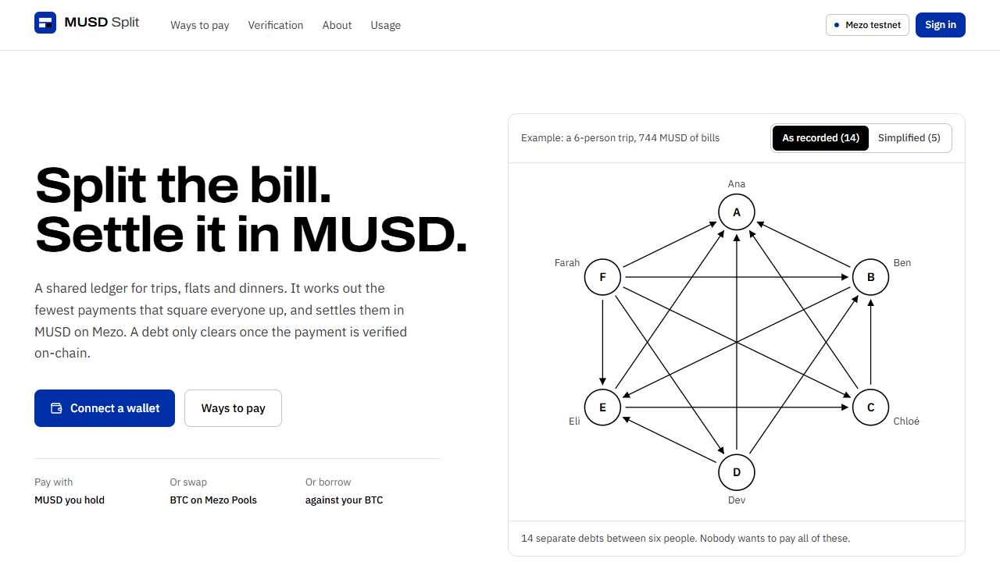 | 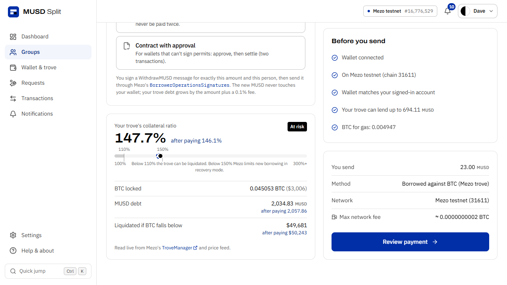 |
| **Wallet and trove** | **Group balances** |
| 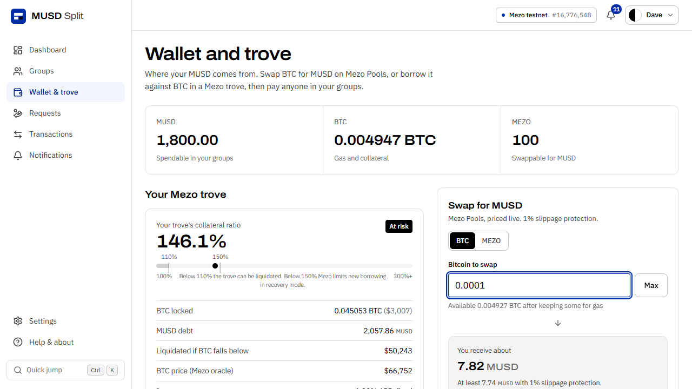 | 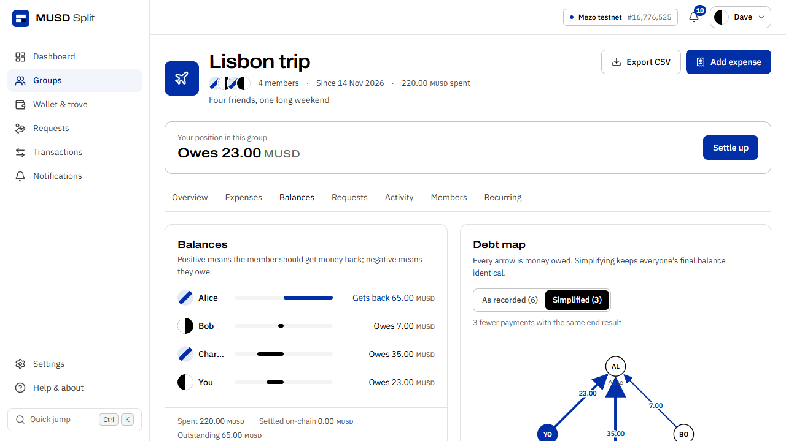 |
| **Dashboard** | **Payment confirmed on-chain** |
| 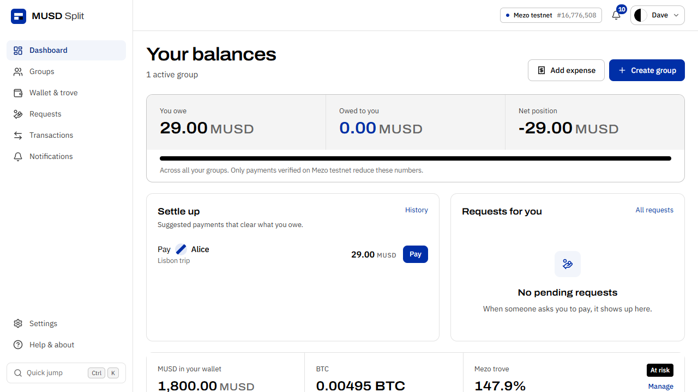 | 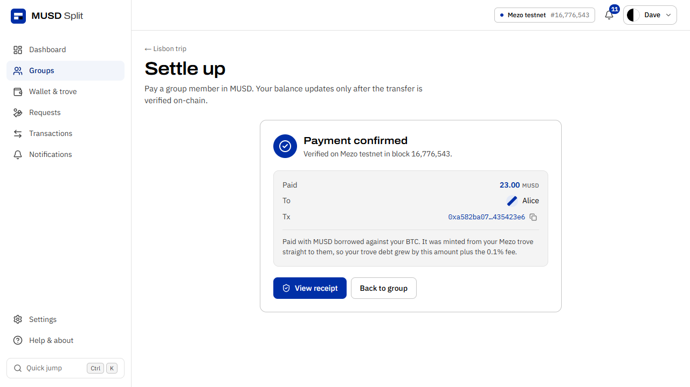 |

| Phone: landing | Phone: dashboard | Phone: group | Phone: wallet |
|---|---|---|---|
| 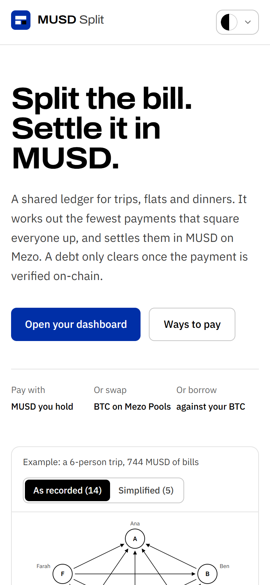 | 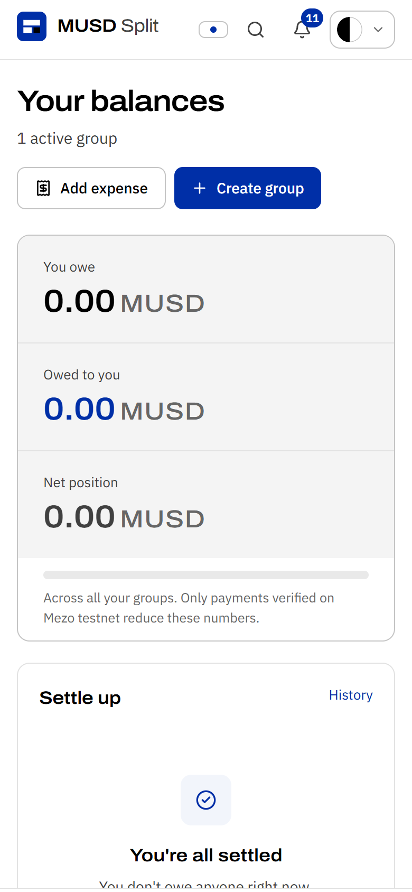 | 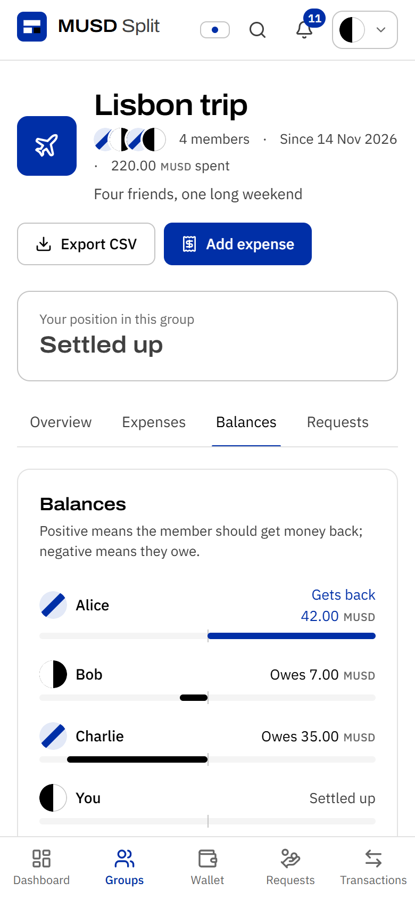 | 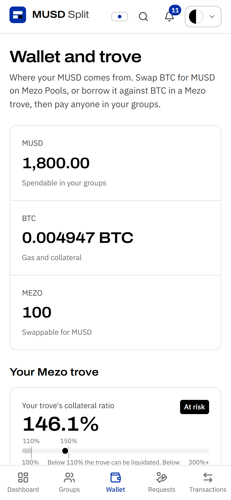 |

Design: three colours only, solid blue `#002FA7`, black and white. No gradients, glows or glass. Archivo (expanded) for headings, IBM Plex Sans for the interface, Plex Mono for hashes. Every page works from 360 px phones up, with no horizontal scroll.

## Architecture

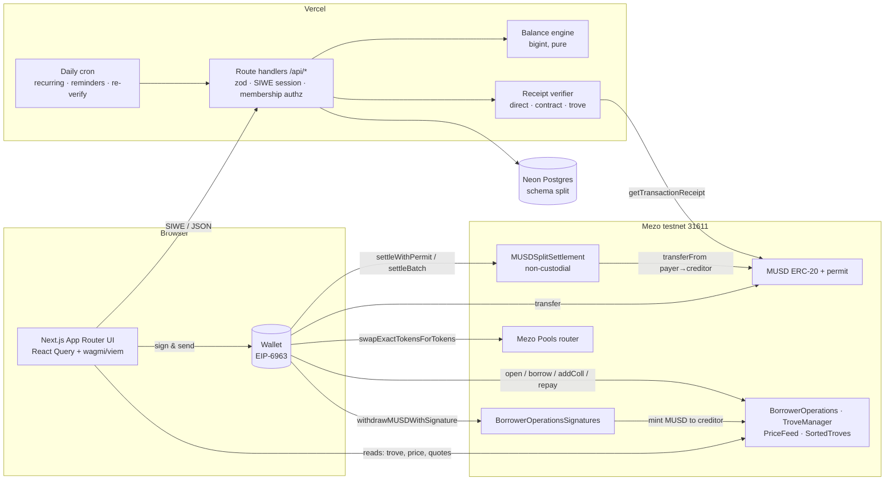

## How a payment is verified

1. **Intent.** `POST /api/groups/:id/settlements` checks membership and the policy: the amount can't exceed what you owe, minus anything already in flight. It records the intent and the current block. No money has moved.
2. **Sign.** The wallet sends the transaction with an explicit gas limit, `max(estimate × 1.3, floor)`. Mezo's public RPC sometimes under-estimates.
3. **Persist.** The tx hash is saved *before* waiting. A pre-check rejects hashes sent by another wallet or to the wrong contract.
4. **Verify (server).** The server fetches the receipt itself (Mezo RPC with Blockscout as fallback) and checks it:

| Rail | Tx target | The receipt must show |
|---|---|---|
| Direct | MUSD | `Transfer(payer → creditor, exact amount)` from the official token; sent by the payer; mined after the intent |
| Contract / batch | MUSDSplitSettlement | `Settled(id, payer, creditor, amount)` for this intent's id, plus the MUSD `Transfer` |
| **Borrow against BTC** | BorrowerOperationsSignatures | `TroveUpdated(_borrower = payer)` emitted by **BorrowerOperations**, plus `Transfer(0x0 → creditor, exact amount)`, i.e. freshly minted MUSD; sent by the payer; mined after the intent |

5. **Confirm.** A conditional update moves `submitted → confirmed`, then links any payment request and writes activity and notifications. RPC trouble gives `delayed`, which is retried. A revert gives `failed`; a mismatch gives `rejected`, and the hash is released.

## Contracts

| Contract | Address | Notes |
|---|---|---|
| **MUSDSplitSettlement v3 (live)** | [`0x07A97685…2607`](https://explorer.test.mezo.org/address/0x07A97685C16fCd717a66c7cCf974fFfB6f8c2607) | Source verified. No owner, no admin, holds no funds. `settle`, `settleWithPermit`, `settleBatch`, `settleBatchWithPermit` (≤ 32 items, atomic). Payer-scoped ids, OpenZeppelin `ReentrancyGuard` + `SafeERC20`. |
| MUSDSplitSettlement v2 / v1 (retired) | [`0x2deedDE2…C48e`](https://explorer.test.mezo.org/address/0x2deedDE2CA49d0B32D4f523DFf66Fc1EDe66C48e) · [`0x2d2F5788…2602`](https://explorer.test.mezo.org/address/0x2d2F57887fA5a970344CeA9f1176BB761aFc2602) | Same bytecode, earlier deployer keys. Both source verified; their payments remain valid history. |

Solidity 0.8.28, EVM `london`, optimizer 200. Deployment records are in [`contracts/deployments/`](./contracts/deployments/).

## Real transactions (production end-to-end runs)

All of these were sent by the e2e scripts against **https://musd-split.vercel.app** with the v3 contract. Each one was verified, or correctly refused, by the live server.

| Step | Result | Tx |
|---|---|---|
| Open a Mezo trove **through the Wallet page UI** (0.045 BTC locked, 1,799 MUSD borrowed) | trove opened at 150.1% | [0x7abad5fd…](https://explorer.test.mezo.org/tx/0x7abad5fd66369d8cfd4fa01156e355cb55cb442e895a0110aa690051feb3c01d) |
| **Borrow 10 MUSD against BTC and pay Alice** (`withdrawMUSDWithSignature`, minted straight to her) | confirmed; trove debt +10.01, ratio 149% | [0xd51dbd5f…](https://explorer.test.mezo.org/tx/0xd51dbd5f65b2e73cb20d664a34a6d24ed2c025660a859b6f7c44ab644866c23d) |
| Borrow minted to the payer himself, submitted for a debt to Alice | **rejected** (`RECIPIENT_MISMATCH`) | [0xa65f3f27…](https://explorer.test.mezo.org/tx/0xa65f3f2751ef39c4b63a39435c9c1b3bb552b31a0d5b664487362f1a5a24bf91) |
| Mezo Pools: approve BTC (exact amount), swap 0.00005 BTC for 3.9 MUSD | confirmed | [approve](https://explorer.test.mezo.org/tx/0xaeb41a1769ffba9c042b87503d556a5eef489f0956d6adfce57bec920f34b958) · [swap](https://explorer.test.mezo.org/tx/0xf0386d570c3f60c206d1e471624b4975cb9b46f32c014be7b7eb67fa89b1cee5) |
| Bob settles 30 MUSD with a direct transfer | confirmed | [0xb992cfb1…](https://explorer.test.mezo.org/tx/0xb992cfb1be165c64dbf63130f7c7dc9759af72313c24d78e0e7579fcbb1c5f97) |
| Charlie sends 1 MUSD for a 30 MUSD payment | **rejected** (`AMOUNT_MISMATCH`) | [0xef41b970…](https://explorer.test.mezo.org/tx/0xef41b97081a330ac9c80f4159c30ed4a64072e1534e679099a848b4f7a29b272) |
| A transfer that reverts | **failed**, nothing counted | [0x0678a517…](https://explorer.test.mezo.org/tx/0x0678a517211a638bf8d6c96775f19b0991eb69fe3a2a77e176d048b0784806a2) |
| `settleWithPermit` 3 MUSD through the v3 contract | confirmed | [0xc83e9aab…](https://explorer.test.mezo.org/tx/0xc83e9aabb0e8faad4c8314f9e618de727dbc1a92a86c5836cb8d18fc302e1e91) |
| `settleBatchWithPermit` to 2 creditors in one transaction | confirmed | [0x4a361531…](https://explorer.test.mezo.org/tx/0x4a361531e6228cf5b7eb080036b42e9ee0dec96b58e074bbe0634a77cafb7b15) |
| Contract deploy v3 from the main key | verified source | [0x31ba1055…](https://explorer.test.mezo.org/tx/0x31ba10555bd04fb76c8345fcfe4db58546920e55aa3985aebbe5671f83b5d5be) |

## Testing

| Suite | Command | Result |
|---|---|---|
| Unit: balance engine, receipt verifier (all three rails), trove maths, validation, recurrence, CSV | `npm test` | **129 / 129** |
| Contract (Hardhat) | `npm run contracts:test` | **28 / 28** |
| Live e2e, core flows, against **production** | `BASE_URL=https://musd-split.vercel.app npm run e2e:testnet` | **53 / 53** |
| Live e2e, Mezo rails, against **production** | `BASE_URL=https://musd-split.vercel.app npm run e2e:mezo` | **16 / 16** |
| UI tour, real browser clicks and a real borrow-and-pay | `npm run demo:tour -- --shots` | passes; screenshots in `docs/screenshots/` |
| Open a trove through the UI | `npx tsx scripts/open-trove-ui.ts` | passed: [tx](https://explorer.test.mezo.org/tx/0x7abad5fd66369d8cfd4fa01156e355cb55cb442e895a0110aa690051feb3c01d) (0.045 BTC locked, 1,799 MUSD borrowed, 150.1%) |
| Types, lint, build | `npm run typecheck` · `npm run lint` · `npm run build` | clean |

The core e2e run covers:
- **Setup:** SIWE (including a nonce replay), unauthenticated 401s, non-member 403s, revoked and guessed invites, and a 90 MUSD expense split 30/30/30.
- **Payments:** a real direct payment verified by the server, a request marked paid only after verification, and double payment blocked.
- **Rejections:** someone else's tx hash, a wrong amount (1 for 30) and a reverting transfer.
- **Contract:** `settleWithPermit` and `settleBatchWithPermit` through the v3 contract.
- **Ledger edits:** percentage-split rounding, an adjustment that requires a reason, and a stale-version edit returning 409.

The Mezo run covers:
- borrow-and-pay from a trove, with a rejected self-borrow and the exact debt growth (amount + 0.1%);
- the trove staying healthy afterwards;
- a Mezo Pools BTC → MUSD swap.

## Security summary

Full write-up: [`docs/SECURITY.md`](./docs/SECURITY.md).
- **Non-custodial throughout.** No keys requested or stored, and the contract never holds funds.
- **Never trusts the client.** Only server-fetched receipts confirm payments. Tx hashes and log indexes are unique; intents are bound to a block or to an on-chain id.
- **This review fixed nine app issues,** each with its regression where possible. Examples: rejected hashes no longer blacklisted forever, late transactions still attachable to cancelled attempts, "Payment not sent" never shown after a broadcast, roles reset on rejoin, and 503 instead of unbound intents when the RPC is down.
- **Testnet only.** The contract is reviewed and tested but has not had an external audit.

## Business model and team

See **https://musd-split.vercel.app/about**. Splitting, and paying with MUSD you hold, stay free. Revenue comes from:
- an interface fee on borrow-and-pay;
- a routing fee on in-app swaps;
- *Group Pro* for households and clubs;
- business accounts for co-living and travel operators.

None of it is switched on during testnet. The team section lives in `src/config/team.ts`.

## Local setup

```bash
npm install
vercel link --yes --project musd-split && vercel env pull .env.local --yes   # or copy .env.example
npm run db:migrate          # idempotent SQL → schema "split" (001_init, 002_trove_settlements)
npm run dev                 # http://localhost:3000
```

Scripts (testnet keys live only in gitignored `.env*` files and are never printed):

```bash
npm run wallets -- fund                                   # create + fund alice/bob/charlie from the main wallet
BASE_URL=http://localhost:3000 npm run e2e:testnet        # core flows, real transactions
BASE_URL=http://localhost:3000 npm run e2e:mezo           # borrow-and-pay + Mezo Pools swap
BASE_URL=http://localhost:3000 npm run demo:tour -- --video --shots
cd contracts && npm install && npm test                   # 28 Hardhat tests
DEPLOYER_ENV_FILE=../.env.deployer npm run deploy:testnet
```

Environment variables:
- `DATABASE_URL`
- `SESSION_SECRET`
- `CRON_SECRET`
- `STATS_TEST_WALLETS`: comma-separated public addresses whose groups count as team test activity
- optional `MEZO_RPC_URL` and `NEXT_PUBLIC_SITE_URL`

See [`.env.example`](./.env.example).

## Money maths

- All amounts are `bigint` MUSD base units (18 decimals). Decimal strings appear only at the edges. No floats.
- Shares are whole cents. Leftover cents go to the largest fractional remainder; ties go to the payer first, then by address. Shares always sum to the total.
- Net balances always sum to zero. Simplification preserves every net with at most *n − 1* transfers.
- Trove maths mirrors the protocol: ratio = coll × price / (principal + interest including accrued); NICR = coll × 10²⁰ / principal; liquidation price = debt × MCR / coll.

## Known limitations

- Testnet only. The settlement contract is reviewed but not externally audited.
- **No users outside the team yet.** The Usage page says so and counts the first real group automatically.
- Opening a trove needs the protocol minimum (1,800 MUSD debt, about 0.045 BTC at a 150% ratio). For small debts, the swap path is the practical option.
- The Vercel Hobby cron runs once a day. While a page is open it polls and offers *Check again*.
- Notifications are in-app only. Single currency (MUSD).

## Roadmap

- **Next:** email and push reminders, shareable read-only group summaries, installable mobile app (PWA), a second contract review.
- **Mainnet:** external audit, launch on Mezo mainnet, switch on the interface fees, Group Pro.
- **Later:** scheduled payments with spending limits, multi-currency expenses with on-chain FX snapshots, business accounts and an API.

## Repository layout

```
src/lib/engine/         pure balance engine (money, split, balances, simplify, coverage, adjustments, settlement policy)
src/lib/mezo/           pure trove maths (ratio, liquidation price, borrow capacity, open-trove quote)
src/lib/chain/verify.ts pure receipt verification (direct, contract, trove rails)
src/lib/client/         wallet-side code: settle.ts (payments), mezo.ts (troves, borrow-and-pay, Mezo Pools)
src/lib/server/         db, SIWE, sessions, authz, expenses, settlements, invites, requests, recurring, stats
src/app/                pages (landing, about, stats, app) and API route handlers
src/components/         UI, settle flow, Mezo trove + swap components
contracts/              Hardhat project (MUSDSplitSettlement, tests, deploy and verify scripts, deployments)
db/migrations/          idempotent SQL
scripts/                db-migrate, e2e-testnet, e2e-mezo, demo-tour, open-trove-ui, testnet-wallets
tests/                  Vitest suites
docs/                   SECURITY.md, SUBMISSION.md, screenshots, demo video
```
